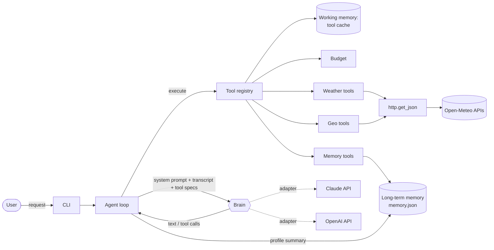
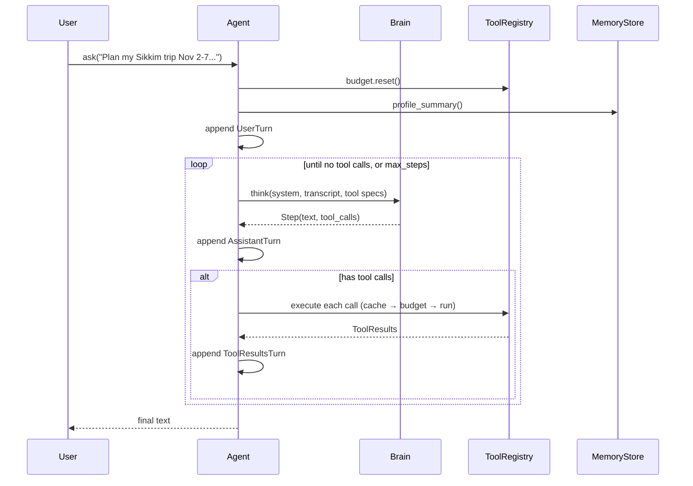
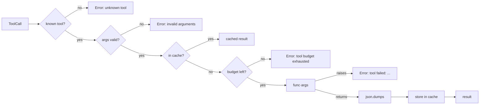

# Architecture: Weather Planning Agent

| | |
|---|---|
| **Status** | Draft v1. Describes the target design for M2; §10 shows what is built |
| **Last updated** | 2026-10-28 |
| **Related** | [PRD](PRD.md) · [High-level design](HLD.md) · [Task list](TASKS.md) |

## 1. Overview

The agent has three parts, wired together by an agent loop we own:

- **Brain:** an AI model (Claude or OpenAI) that plans, chooses tools, and writes the answer.
- **Memory:** *working memory* for the current session and *long-term memory* that persists between sessions.
- **Tools:** functions that fetch facts (Open-Meteo) or compute them (distance). They are the only source of numbers.



**Design principles**
1. **The model decides, code computes.** Forecasts, distances, averages, and AQI categories come from tools. The
   Brain chooses what to fetch and explains what it means (PRD R2).
2. **Provider-agnostic core.** The loop, memory, and tools know nothing about Claude or OpenAI. Each provider is an
   adapter behind the `Brain` interface.
3. **Everything testable offline.** Every external boundary (HTTP, AI SDKs, the file system) has a fake used by
   unit tests.
4. **Bounded and honest.** A tool budget caps cost. Failures surface as `Error:` results the Brain must report,
   never as made-up data.

## 2. Module layout

```
weather_agent/
├── __main__.py          # CLI entry: python -m weather_agent            (T2.15)
├── agent.py             # Agent loop, system prompt assembly             (T2.12)
├── prompts.py           # Static instructions: R1-R10, M1-M4            (T2.16)
├── types.py             # ToolCall, Step, ToolResult, transcript turns   (T2.12)
├── brain/
│   ├── base.py          # Brain protocol                                 (T2.12)
│   ├── claude.py        # Claude Messages API adapter                    (T2.13)
│   └── openai.py        # OpenAI Chat Completions adapter                (T2.14)
├── memory/
│   ├── store.py         # Long-term MemoryStore (JSON file)              ✅ T2.9
│   └── cache.py         # Working-memory ToolCache                       (T2.10)
└── tools/
    ├── http.py          # Single HTTP entry point                        ✅ T0.2
    ├── weather.py       # Forecast, hourly, air quality, climate normals ✅ T2.1-T2.4
    ├── geo.py           # Distance, elevation                            ✅ T2.5-T2.6
    ├── budget.py        # ToolBudget                                     ✅ T2.7
    ├── memory_tools.py  # remember / recall / forget                     (T2.11)
    └── registry.py      # ToolSpec, ToolRegistry, default tool set       (T2.8)
tests/                   # Unit tests; live tests marked @pytest.mark.live
agent.py, agent_openai.py  # Prototype agents, deleted when T2.15 lands
```

**Dependency rule:** `tools/` and `memory/` import nothing from `brain/` or `agent.py`. `brain/` imports only
`types.py`. Only `agent.py` and `__main__.py` connect the layers.

## 3. Core types (`types.py`)

```python
@dataclass
class ToolCall:
    id: str                 # provider-issued id, echoed back with the result
    name: str
    args: dict

@dataclass
class ToolResult:
    call_id: str
    content: str            # JSON string on success, "Error: ..." on failure
    is_error: bool = False

@dataclass
class Step:                 # one Brain response
    text: str               # visible text (may be empty when only calling tools)
    tool_calls: list[ToolCall]
    stop_reason: Literal["end", "tool_use", "max_tokens", "refusal"]
    raw: Any = None         # provider-native assistant message, replayed unchanged

# Transcript = list of turns, append-only
UserTurn(text: str)
AssistantTurn(step: Step)
ToolResultsTurn(results: list[ToolResult])
```

**Why `Step.raw`:** Claude returns thinking blocks that must be sent back **unchanged** in later requests, and
changing earlier turns can be rejected (preserved thinking). The adapter keeps the provider's original assistant
content in `raw` and replays it as-is. The transcript is therefore **append-only**: nothing is edited or removed
during a session.

## 4. Brain

### 4.1 Interface (`brain/base.py`)

```python
class Brain(Protocol):
    name: str
    def think(self, system: str, transcript: list[Turn], tools: list[ToolSpec]) -> Step: ...
```

An adapter's job is pure translation: neutral transcript → provider request, provider response → `Step`. Adapters
contain no planning logic and do not run tools.

### 4.2 Claude adapter (`brain/claude.py`)

| Concern | Decision |
|---|---|
| Model | `claude-opus-5-5` (overridable with `CLAUDE_MODEL`) |
| Call | `client.beta.messages.create`, non-streaming, `max_tokens=16000` |
| Thinking / effort | Thinking is always on for this model; `output_config={"effort": "medium"}` set explicitly |
| Refusals | `betas=["server-side-fallback-2026-07-01"]`, `fallbacks="default"`. A final `refusal` becomes `Step(stop_reason="refusal")` |
| Tools | `{name, description, input_schema}` from `ToolSpec` |
| Replay | `AssistantTurn` → `{"role": "assistant", "content": step.raw}`; tool results → one `user` message containing all `tool_result` blocks |
| Tool choice | `auto` (forced tool choice is rejected by this model) |
| Caching | Static instructions first in `system`, then date and profile (see §6.3), so the prefix stays cacheable |

### 4.3 OpenAI adapter (`brain/openai.py`)

| Concern | Decision |
|---|---|
| Model | `OPENAI_MODEL`, default `gpt-5` |
| Call | `client.chat.completions.create` with `tools=[{"type": "function", ...}]` |
| Replay | `AssistantTurn` → `step.raw` (assistant message dict with `tool_calls`); each `ToolResult` → `{"role": "tool", "tool_call_id", "content"}` |
| Bad arguments | Arguments that aren't valid JSON become a `ToolCall` whose args flag the parse error; the registry returns an `Error:` result |

### 4.4 Testing the Brain boundary

- `FakeBrain(steps: list[Step])` returns scripted steps and records what it was given. It drives all agent-loop tests.
- Adapter tests use a fake SDK client: they check the request built from a transcript and the `Step` parsed from a
  canned response.
- One `@pytest.mark.live` smoke test per adapter.

## 5. Agent loop (`agent.py`)

```python
class Agent:
    def __init__(self, brain: Brain, registry: ToolRegistry, store: MemoryStore,
                 max_steps: int = 40, on_event: Callable[[str, dict], None] = noop): ...
    def ask(self, text: str) -> str: ...
```



**Rules**
- All tool calls in one step are run, and their results go back together in one `ToolResultsTurn`.
- `stop_reason == "refusal"` ends the request with a clear message. `max_tokens` ends it with a note that the answer
  was cut off.
- After `max_steps` the loop stops and returns the last text with a "stopped early" note (T2.12 AC4). This backs up
  the tool budget, which normally stops searches earlier.
- If a Brain call raises an API error, everything appended for the failed request is removed before the error
  reaches the CLI, so the session stays usable. This is the one exception to append-only: it only removes turns the
  provider never accepted.
- `on_event` sends `tool_call`, `tool_result`, and `text` events to the CLI for live progress display.

## 6. Memory

### 6.1 Working memory (one session)

| Part | Where | Purpose |
|---|---|---|
| Transcript | `Agent.transcript` | The conversation, including tool calls and results; makes follow-ups work (R10) |
| Tool cache | `memory/cache.py` `ToolCache` | Repeated identical lookups are served from memory: no API call and no budget used |

**Cache key:** `(tool_name, json.dumps(args, sort_keys=True))`. Errors are never cached. Memory tools are marked
`cacheable=False`. The cache lives for the session; a forecast won't change meaningfully within one conversation.

### 6.2 Long-term memory (across sessions)

`MemoryStore` stores a JSON file, by default at `~/.weather_agent/memory.json` (`WEATHER_AGENT_MEMORY` overrides it):

```json
{
  "entries": [
    {"id": "3f9a1c2e", "kind": "preference", "content": "Son has asthma: keep AQI under 100", "created": "2026-10-28"}
  ]
}
```

| Kind | Loaded into the system prompt? | Example |
|---|---|---|
| `profile` | Yes, every session | "Lives in Pune" |
| `preference` | Yes, every session | "Doesn't run above 30 °C" |
| `plan` | No: the Brain uses `recall` | "Sikkim trip Nov 2-7: trek on Nov 4" |
| `outcome` | No: the Brain uses `recall` | "Nov 4 trek: rained after 2 pm despite clear forecast" |

Writes go to a temporary file that then replaces the original, so a crash can't leave a half-written file. A file
that can't be read is renamed to `.bak` and the store starts empty. Duplicates (same kind, same text ignoring case)
are not stored twice.

### 6.3 How memory reaches the Brain

```
system prompt = STATIC_INSTRUCTIONS            (prompts.py; identical every request → cacheable)
              + "Today is 2026-10-28."
              + "What you know about this user:\n- Lives in Pune\n- ..."   (profile_summary)
```

Plans and outcomes are fetched on demand with `recall`, which keeps the prompt small. The Brain saves new facts with
`remember` and must tell the user when it does (PRD M1). The CLI's `/memory` and `/forget` commands call the store
directly, without going through the Brain (PRD M2).

## 7. Tools

### 7.1 Registry (`tools/registry.py`)

```python
@dataclass
class ToolSpec:
    name: str
    description: str
    parameters: dict          # JSON Schema: type=object, properties, required, additionalProperties=false
    func: Callable[..., Any]  # returns JSON-serialisable data, or raises
    cacheable: bool = True

class ToolRegistry:
    def __init__(self, specs: list[ToolSpec], budget: ToolBudget, cache: ToolCache): ...
    def specs(self) -> list[ToolSpec]: ...
    def execute(self, call: ToolCall) -> ToolResult: ...   # never raises
```

**`execute` pipeline**



Arguments are checked in code (required fields present, basic JSON types match the schema) before the budget is
charged, so a malformed call costs nothing. The full `jsonschema` package isn't needed for these flat schemas.

### 7.2 Tool catalogue

| Tool | Function | External call | Cacheable |
|---|---|---|---|
| `find_location` | `weather.geocode` | Open-Meteo Geocoding | ✔ |
| `get_weekly_forecast` | `weather.forecast` | Open-Meteo Forecast | ✔ |
| `get_hourly_forecast` | `weather.hourly_forecast` | Open-Meteo Forecast | ✔ |
| `get_air_quality` | `weather.air_quality` | Open-Meteo Air Quality | ✔ |
| `get_climate_normals` | `weather.climate_normals` | Open-Meteo Archive | ✔ |
| `get_distance` | `geo.distance` | none (computed) | ✔ |
| `get_elevation` | `geo.elevation` | Open-Meteo Elevation | ✔ |
| `remember` / `recall` / `forget` | `memory_tools.*` → `MemoryStore` | local file | ✘ |

### 7.3 External services

All HTTP goes through `tools/http.get_json` (standard library `urllib`, 20 s timeout). It only allows HTTPS to the
four Open-Meteo hosts and refuses anything else before connecting (T2.18). Open-Meteo needs no key; its
free tier is **non-commercial** and rate-limited (PRD §10). A complex request may make about 10-30 calls, well
within the limits for personal use.

## 8. Configuration

| Variable | Default | Used by |
|---|---|---|
| `ANTHROPIC_API_KEY` (or `ant auth login`) | none | Claude adapter |
| `CLAUDE_MODEL` | `claude-opus-5-5` | Claude adapter |
| `OPENAI_API_KEY` | none | OpenAI adapter |
| `OPENAI_MODEL` | `gpt-5` | OpenAI adapter |
| `AGENT_MAX_TOOL_CALLS` | `30` | `ToolBudget` |
| `WEATHER_AGENT_MEMORY` | `~/.weather_agent/memory.json` | `MemoryStore` |

CLI flag `--provider claude|openai` (default `claude`) selects the Brain.

## 9. Testing strategy

| Layer | Fake | Example checks |
|---|---|---|
| Tools | `FakeApi` replaces `http.get_json` (`tests/conftest.py`) | Parsing, clamping, error cases |
| Registry | Fake tool functions | Cache before budget, errors never raise, argument validation |
| Memory | Temporary directory (`tmp_path`) | Persistence, duplicates, corrupted-file recovery |
| Agent loop | `FakeBrain` with scripted steps | Tool round-trips, parallel calls, max steps, profile in prompt |
| Adapters | Fake SDK client | Request shape, replay of `raw`, refusal handling |
| End-to-end | Real APIs, `@pytest.mark.live` | One smoke test per provider |
| Behaviour | Eval scenarios (M3) | Constraint satisfaction, grounding, agent vs fixed-workflow baseline |

`pytest` runs only offline tests by default. `pytest -m live` runs the live ones.

## 10. Implementation status

| Component | Status |
|---|---|
| `tools/http`, `weather`, `geo`, `budget` | ✅ Built and tested |
| `memory/store` | ✅ Built and tested |
| `types`, `memory/cache`, `tools/registry`, `tools/memory_tools` | ⏳ Next (T2.8, T2.10, T2.11) |
| `brain/*`, `agent`, `prompts`, `__main__` | ⏳ After that (T2.12-T2.16) |
| Root `agent.py`, `agent_openai.py` | Prototypes still working; removed in T2.15 |

## 11. Design decisions

| # | Decision | Why | Trade-off |
|---|---|---|---|
| D1 | **We own the agent loop** instead of using an SDK's tool runner | Works the same for both providers; budget, cache, and events in one place; testable with `FakeBrain` | We handle message replay ourselves (§3) |
| D2 | **Memory is our own tools + a JSON file**, not a provider's memory feature | Works the same for Claude and OpenAI; the user can open and edit the file | Simple keyword search; no semantic search yet |
| D3 | **Open-Meteo** as the only data source | Free, no key, forecast + air quality + history + elevation from one provider | Non-commercial licence; one provider is a single point of failure |
| D4 | **Calculations in code** (distance, averages, AQI categories) | Correct and repeatable; the model can't miscalculate them | Road distance is an estimate until routing (T4.1) |
| D5 | **Standard library `urllib`** for HTTP | No extra dependency for simple GET requests | No connection pooling or automatic retries |
| D6 | **Chat Completions** for OpenAI | Simplest stable tool-calling API; the transcript maps directly onto it | Could move to the Responses API later, inside the adapter only |
| D7 | **Append-only transcript** | Required to replay Claude's thinking correctly; easier to reason about | No editing history to save tokens; long sessions rely on the budget and short tool outputs |

## 12. Extending the system

**Add a tool:** write a function in `tools/` that returns JSON-serialisable data and raises on failure → add a
`ToolSpec` to the default registry → add tests with `FakeApi` → mention it in `prompts.py` if the Brain needs
guidance on when to use it.

**Add a provider:** implement `Brain.think` in `brain/<provider>.py`, translating the transcript and specs → add
adapter tests with a fake client → add it to `--provider`.

**Change memory storage** (e.g. a database for multi-user use): keep the `MemoryStore` method names
(`remember`, `recall`, `forget`, `profile_summary`) and swap the storage underneath.

## 13. Open issues

- **Routing provider for UC3** (PRD §12 Q2): this decides how `get_route` is built.
- **Candidate places for UC2** (PRD §12 Q3): model knowledge checked by geocoding, or a places database.
- **Long sessions:** with an append-only transcript, very long chats grow without limit. Revisit after the M3
  evals show typical sizes.
- **Multi-user memory:** only needed if PRD §12 Q1 is answered "offered to others".
