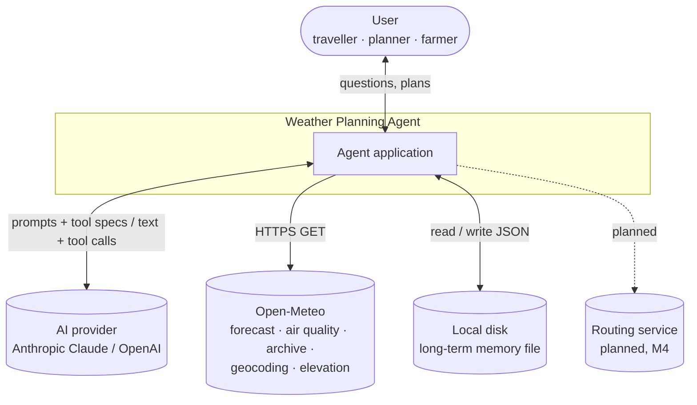
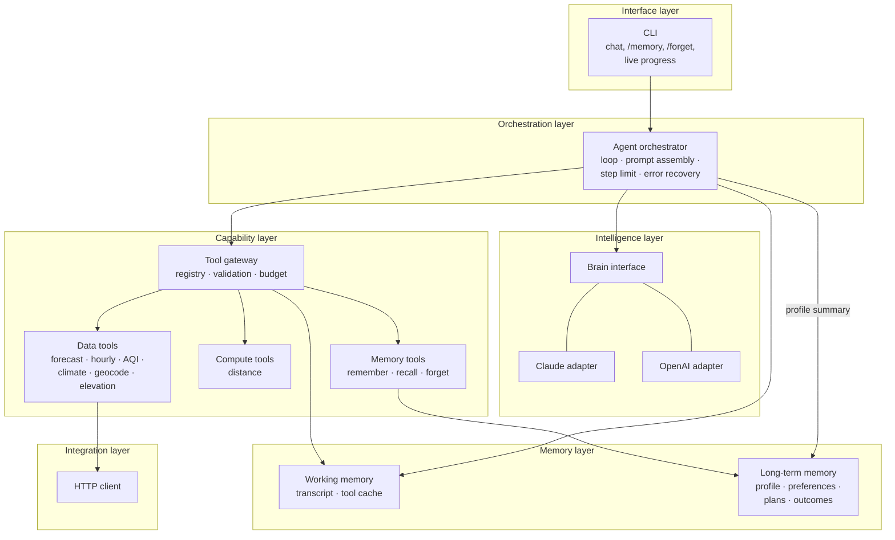
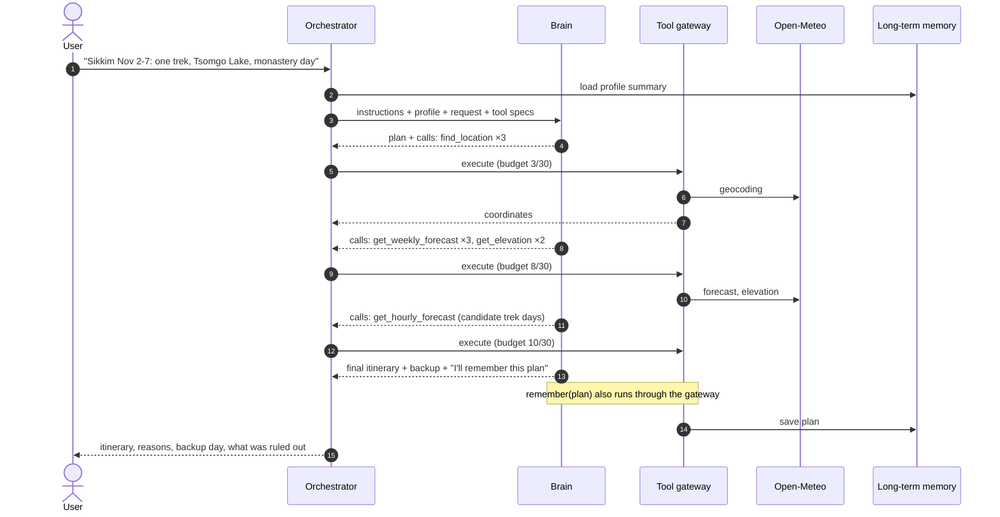
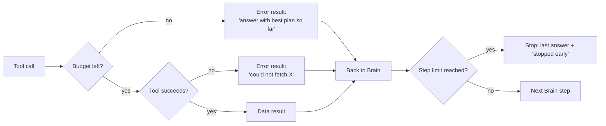
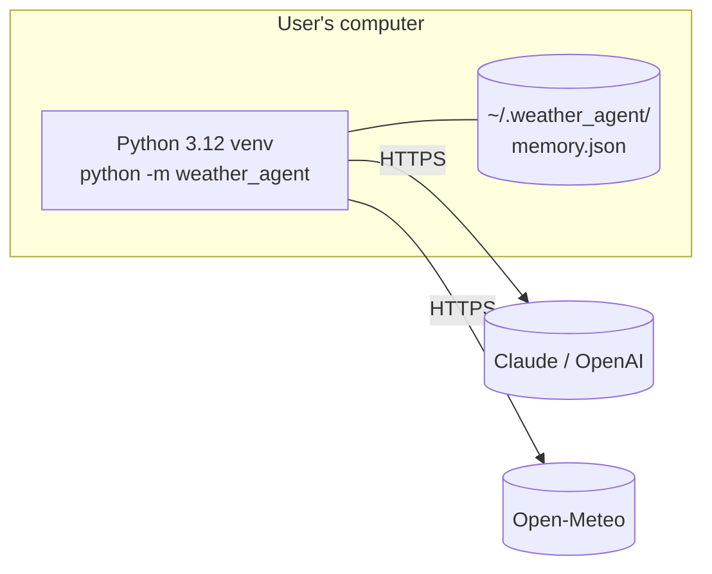
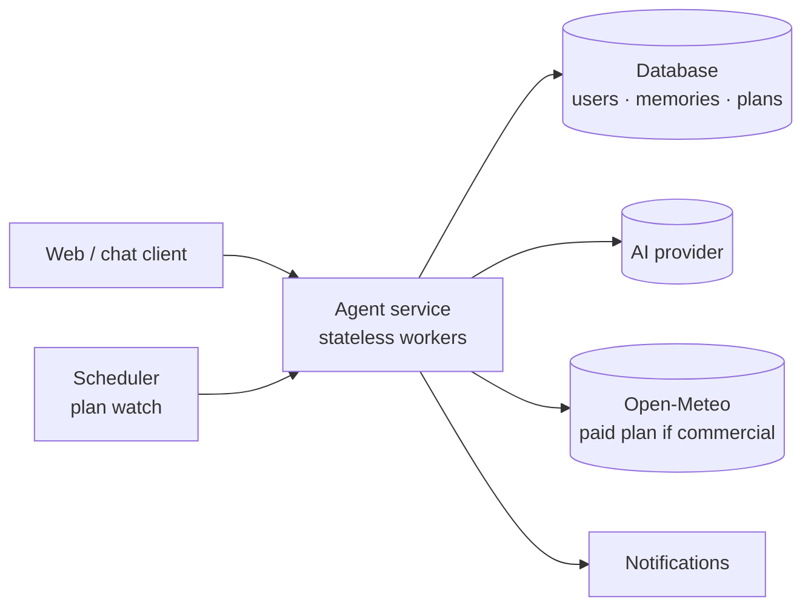

# High-Level Design: Weather Planning Agent

| | |
|---|---|
| **Status** | Draft v1 for review |
| **Last updated** | 2026-10-28 |
| **Related** | [PRD](PRD.md) (what and why) · [Architecture](ARCHITECTURE.md) (detailed design: types, interfaces, module layout) · [Task list](TASKS.md) |

## 1. Purpose and scope

This document describes the system at the level of **components, data flows, deployment, and quality attributes**.
It is the reference for design reviews and for deciding where new features fit. Class-level interfaces are in
[ARCHITECTURE.md](ARCHITECTURE.md).

**In scope:** v1 (local CLI, single user, use cases UC1-UC5) and the planned path to v2 (plan watch UC6, a web or
chat interface).
**Out of scope:** forecasting models (provided by Open-Meteo), booking or payments, official weather warnings.

## 2. System context

| External system | What we use it for | Interface | Constraints |
|---|---|---|---|
| **Anthropic Claude** (default) | Reasoning and planning | Messages API, HTTPS, API key | Pay per token; rate limits per account |
| **OpenAI** (alternative) | Same role, other provider | Chat Completions API, HTTPS, API key | Pay per token |
| **Open-Meteo** | All weather, air-quality, historical, geocoding, and elevation data | REST/JSON, no key | Free tier is **non-commercial** and rate-limited |
| **Local disk** | Long-term memory | JSON file | Single user, single machine |
| **Routing service** (M4) | Road routes for journey timing (UC3) | TBD | Provider not chosen (PRD §12 Q2) |

## 3. Logical architecture

| Component | Responsibility | Does **not** do |
|---|---|---|
| **CLI** | Takes input, shows progress and answers, handles memory commands | Planning, tool execution |
| **Agent orchestrator** | Runs the think → act → observe loop; builds the system prompt; enforces the step limit; recovers from API failures | Provider-specific formatting; data fetching |
| **Brain interface + adapters** | Translates between the neutral conversation format and each provider's API | Running tools, holding state |
| **Tool gateway** | Single entry point for all tools: argument checks, cache lookup, budget, error wrapping | Deciding *which* tool to call |
| **Data tools** | Fetch and normalise Open-Meteo data into compact JSON | Interpretation or advice |
| **Compute tools** | Calculations: distance, drive-time estimate | External calls |
| **Memory tools** | Let the Brain save, search, and delete long-term memories | Deciding what's worth remembering |
| **Working memory** | Conversation transcript and tool-result cache for one session | Persisting anything |
| **Long-term memory** | Durable user facts, preferences, plans, outcomes | Search beyond keyword matching (v1) |
| **HTTP client** | One place for all outbound HTTP (timeouts; faked in tests) | Retries (v1) |

**Layering rule:** each layer only calls the layer below it. Lower layers know nothing about AI providers, so the
capability, memory, and integration layers can be reused (by the M3 baseline workflow, for example).

## 4. Key flows

### 4.1 Planning request (UC1 trip itinerary)

The Brain decides the number and order of calls from what each result shows. The orchestrator only enforces limits.

### 4.2 Limits and failures

Failures become information for the Brain, which must report them (PRD R9). The session never crashes because of one
failed lookup or AI call.

### 4.3 Memory lifecycle

| Event | What happens |
|---|---|
| Session start | Profile and preferences are loaded into the system prompt |
| User shares a lasting fact | Brain calls `remember` and tells the user (PRD M1) |
| Plan agreed | Brain saves it as a `plan` memory, available in later sessions |
| Follow-up in a later session | Brain calls `recall` to find the plan |
| `/memory`, `/forget <id>` | CLI reads or deletes directly, without involving the Brain (PRD M2) |
| Plan watch (M5) | A scheduler loads saved plans, re-checks them, and reports changes |

## 5. Data design

| Entity | Contents | Stored where | Lifetime | Sensitivity |
|---|---|---|---|---|
| **Profile / preference** | Home location, units, limits ("no runs above 30 °C"), health notes | Long-term memory file | Until the user deletes it | **Can include health information.** Local only |
| **Plan** | Goal, dates, places, chosen schedule, backup | Long-term memory file | Until deleted | Location and travel dates |
| **Outcome** | What actually happened vs the forecast | Long-term memory file | Until deleted | Low |
| **Transcript** | Messages, tool calls, results | Process memory | One session | Sent to the AI provider |
| **Tool cache** | Tool + arguments → result | Process memory | One session | Low |
| **Weather data** | Forecasts, AQI, history | Not stored (cache only) | One session | Public data |

Long-term memory is a single JSON file. Writes replace it atomically, and a damaged file is set aside as `.bak`
([ARCHITECTURE §6.2](ARCHITECTURE.md#62-long-term-memory-across-sessions)).

## 6. Deployment

### 6.1 v1: local (current target)

- Installed from the repo with `pip install -r requirements.txt` into a virtual environment.
- API keys come from environment variables, or from an `ant auth login` profile for Claude.
- No server, no database, no open ports.

### 6.2 v2: hosted (proposed, M5; depends on PRD §12 Q1 and Q3)

What changes from v1:
- `MemoryStore` is backed by a database, with the same methods and records keyed by user.
- Sessions move from process memory to the database, so any worker can continue a conversation.
- User login, a commercial Open-Meteo plan, and per-user rate limits are added.
- The orchestrator, Brain, and tools stay the same. That is the main payoff of the layering in §3.

## 7. Technology stack

| Concern | Choice | Reason |
|---|---|---|
| Language | Python 3.12 | Official SDKs for both providers; quick to iterate |
| AI SDKs | `anthropic`, `openai` | Official clients |
| Default model | `claude-opus-5-5` | Strong multi-step planning; OpenAI model configurable |
| HTTP | Standard library `urllib` | No extra dependency for simple GET requests |
| Storage | JSON file | No setup for one user; replaceable (§6.2) |
| Tests | `pytest`, with fakes at every external boundary | Fast, offline, repeatable |
| Diagrams / docs | Markdown + Mermaid | Live in the repo, displayed by GitHub and VS Code |

## 8. Quality attributes

### 8.1 Performance

| Item | Expected | Notes |
|---|---|---|
| Open-Meteo call | ~0.2-1 s | Repeats served from cache in ~0 ms |
| Brain step | ~3-15 s | Depends on model, effort, and conversation length |
| Complex plan (UC1-UC5) | **< 60 s** target | Typically 5-10 Brain steps and 10-25 tool calls; progress shown live |

Calls the Brain makes in the same step can run in parallel, which is a later optimisation if the latency target is
missed.

### 8.2 Cost

The main cost is AI tokens. Every Brain step resends the conversation so far, so cost grows with the number of
steps. **Rough estimate for one complex plan with Claude Opus 5.5:** about 50-80k input and 5-10k output tokens,
roughly **$0.10-0.50**, lower when prompt caching applies. These are estimates to be replaced by measurements from
the M3 evals.

**What keeps cost down:**
- the tool budget (30 calls)
- the step limit
- the tool cache
- compact tool outputs
- a fixed system prompt prefix, so prompt caching can work
- `medium` effort by default

### 8.3 Reliability

| Failure | Behaviour |
|---|---|
| Open-Meteo slow or down | 20 s timeout → `Error:` result → Brain reports what it couldn't check |
| AI API error (429, 5xx, network) | SDK retries (2 by default); if it still fails, the request is undone and the user can retry |
| AI refusal | Claude's server-side fallback first; otherwise a clear message |
| Damaged memory file | Set aside as `.bak`; the agent continues with empty memory |
| Runaway exploration | Tool budget, then step limit |

### 8.4 Security and privacy

- **Secrets:** API keys only in environment variables or the provider's login profile. Never in code, memory, or logs.
- **Personal data:** memories can include health and travel details. They stay on the user's machine, the agent
  announces every save, and the user can list and delete them. Conversation content is sent to the selected AI
  provider.
- **Prompt injection:** tool results and stored memories are treated as **data, not instructions**. Open-Meteo
  returns numbers, so the risk is low. Memory text is written by the user or the agent and is quoted to the Brain as
  facts.
- **Outbound calls:** only to the AI provider and Open-Meteo (routing service from M4). No inbound network access in
  v1.

**How each commitment is enforced** (`tests/test_security.py`, task T2.18)

| Commitment | Enforcement | Status |
|---|---|---|
| Outbound data calls only to Open-Meteo | Host and HTTPS allow-list in `http.get_json`; refused before any connection opens | ✅ Enforced + tested |
| No direct networking outside `tools/http.py` and `brain/` | Test fails if any other module imports a networking library | ✅ Tested |
| No API keys in the repo | Test scans source, docs, and config for key formats | ✅ Tested |
| No API keys in memory | `MemoryStore.remember` refuses key-like text | ✅ Enforced + tested |
| No API keys in logs | Same check applied to the usage log | ⏳ With T2.17 |
| Memories listable and deletable | Store `recall` / `forget` tested; `/memory` and `/forget` CLI commands | ⚠️ Store done; CLI with T2.15 |
| Injected instructions treated as data | Prompt-injection eval scenarios | ⏳ M3 (T3.1 AC3) |
| Agent announces memory saves | Eval scenarios | ⏳ M3 |

### 8.5 Maintainability and testability

- The layering rule (§3) and one interface per boundary keep changes local: a new provider touches one adapter, and a
  new tool touches the registry.
- Every external boundary has a test fake ([ARCHITECTURE §9](ARCHITECTURE.md#9-testing-strategy)). Behaviour that unit
  tests can't capture is covered by eval scenarios (M3).

### 8.6 Observability (proposed: task T2.17)

For each request, record: provider and model, Brain steps, tool calls (name, cached or not, duration, error), tokens
(input, output, cached), estimated cost, and total time. Show a one-line summary in the CLI and write details to a
local log file. This is also the data source for the cost and latency figures in §8.1-8.2.

## 9. Traceability

| PRD requirement | Where it is handled |
|---|---|
| R1 Plan first, R4 trade-offs, R5 ask only when needed, R6 final check, R7 uncertainty, R8 answer first, R9 safety | Brain instructions (`prompts.py`), checked by M3 evals |
| R2 Grounding | Tool gateway is the only source of data; grounding check in M3 evals |
| R3 Bounded search | Tool gateway budget + orchestrator step limit |
| R10 Follow-ups | Working memory transcript |
| M1-M4 Memory rules | Memory tools + long-term memory + CLI commands + instructions |
| Provider choice | Brain interface with Claude and OpenAI adapters |
| Latency, cost NFRs | §8.1-8.2, measured through §8.6 |
| UC6 Plan watch | Scheduler + saved plans (§6.2, M5) |

## 10. Constraints, assumptions, risks

**Constraints:** Open-Meteo is free for non-commercial use only. v1 is single-user and local. All forecasts come
from a third party.

**Assumptions:** users have an API key for at least one AI provider. Open-Meteo stays available without a key.
Typical requests need fewer than 30 tool calls.

| Risk | Impact | Mitigation |
|---|---|---|
| Open-Meteo outage or policy change | No data → no plans | Errors surfaced clearly; the integration layer isolates the provider so another can be added |
| AI cost higher than expected | Expensive to run | Measure in M3 (§8.6); tune effort, budget, caching |
| Model misreads numbers | Wrong plan | Compact tool outputs; grounding evals |
| Health data in memory | Privacy exposure | Local storage; announced saves; easy deletion |
| v2 storage migration | Rework | `MemoryStore` interface stays fixed; only the storage underneath changes |

## 11. Evolution by milestone

| Milestone | Design change |
|---|---|
| **M2** | Build the orchestrator, Brain adapters, tool gateway, working and long-term memory (this design) |
| **M3** | Add an eval harness alongside the orchestrator; a baseline workflow reuses the capability layer without a Brain loop |
| **M4** | Add a routing integration and `get_route` tool; no other components change |
| **M5** | Scheduler for plan watch; database-backed memory; web or chat interface (§6.2) |
